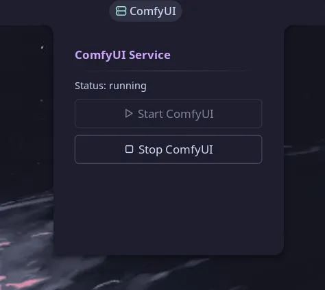

# ComfyUI Control Plugin for Noctalia v5

> A Noctalia v5 plugin that controls and monitors ComfyUI through systemd user service.

## Features

- Displays the current status of the ComfyUI service (running, stopped, failed, unknown)
- Right-click and Left-click context menu with Start/Stop options
- Automatic periodic status polling
- Configurable service name and refresh interval (Middle click to widget to open widget settings)

## Widget Display

The widget displays the ComfyUI service status using an icon and color:
- Green server icon (`server`) when running
- Red server-off icon (`server-off`) when stopped
- Server icon (`server`) when starting or stopping
- Grey server-off icon (`server-off`) when the status cannot be determined

The widget displays `ComfyUI` as its text label. Hovering over it shows the current service status in a tooltip.

## Context Menu

Right-clicking the widget opens a menu with:
- Start ComfyUI button (enabled when service is not running)
- Stop ComfyUI button (enabled when service is not stopped)

## Configuration

The plugin supports the following settings:
- `service_name`: Name of the systemd user service to control (default: "comfyui.service")
- `refresh_interval`: How often to check service status in seconds (default: 5, min: 1, max: 30)

## ComfyUI Systemd Service

This plugin controls ComfyUI through a systemd user service. If you have not configured the service yet, follow the [ComfyUI User Service Setup Guide](docs/comfyui-systemd-service.md).

Once configured, the plugin lets you start and stop ComfyUI directly from the Noctalia bar widget.

## License

MIT License

## Development

This plugin is developed as part of the Noctalia V5 plugin ecosystem.
