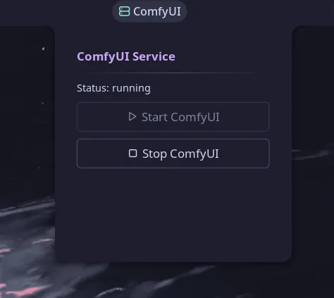

# ComfyUI Control for Noctalia

  [](LICENSE)

A Noctalia v5 bar widget that monitors and controls ComfyUI through a systemd
user service. Start, stop, and check the status of your ComfyUI instance straight from the bar.



## Features

- **Live status** - running, stopped, failed, or unknown, refreshed automatically
- **One-click control** - start/stop via the left- or right-click context menu
- **Configurable** - service name, polling interval, and optional text label
- **Quick settings access** - middle-click the widget to open its settings

## Requirements

- Noctalia v5 (Plugin API 31)
- `systemctl` available in a systemd user session
- ComfyUI configured as a systemd **user** service - see the
  [ComfyUI User Service Setup Guide](docs/comfyui-systemd-service.md) if you haven't set this up yet

## Installation

> This is an unofficial, community-maintained Noctalia plugin.

### Method 1: Git clone

```bash
git clone https://github.com/angelside/noctalia-comfyui-control-widget.git \
  ~/.local/share/noctalia/plugins/noctalia-comfyui-control-widget
```

### Method 2: Download ZIP

1. On GitHub, select **Code → Download ZIP** and extract the archive.
2. Copy the plugin folder into `~/.local/share/noctalia/plugins/`.
3. Verify that `manifest.json` sits directly inside the plugin folder:
    ```text
    ~/.local/share/noctalia/plugins/noctalia-comfyui-control-widget/manifest.json
    ```

### Enable the plugin

1. Open **Settings → Plugins**.
2. Find **ComfyUI Control** in the plugin list and enable it.
3. Add the widget to your bar from the widget picker.

## Usage

### Widget states

| Service state       | Icon         | Color |
| ------------------- | ------------ | ----- |
| Running             | `server`     | Green |
| Stopped             | `server-off` | Red   |
| Starting / stopping | `server`     | -     |
| Unknown             | `server`     | Grey  |

The widget shows a `ComfyUI` text label by default - hide it with the
**Show text** setting. Hovering over the widget shows the current service
status in a tooltip.

### Context menu

Left-click or right-click the widget to open the menu:

- **Start ComfyUI** - enabled when the service is not running
- **Stop ComfyUI** - enabled when the service is not stopped

### Widget settings

Middle-click the widget to open its settings.

## Settings

| Setting            | Type     | Default           | Description                                        |
| ------------------ | -------- | ----------------- | -------------------------------------------------- |
| `service_name`     | `string` | `comfyui.service` | systemd user service to control                    |
| `refresh_interval` | `int`    | `5`               | Status polling interval in seconds (min `1`, max `30`) |
| `show_text`        | `bool`   | `true`            | Show the `ComfyUI` text label on the widget        |

## Troubleshooting

- **Plugin not listed?** Restart Noctalia and confirm `manifest.json` is
  directly inside the plugin folder (not a nested subfolder).
- **Status stuck on unknown?** Check that the service exists and matches
  `service_name`:
    ```bash
    systemctl --user status comfyui.service
    ```

## License

[MIT](LICENSE)
